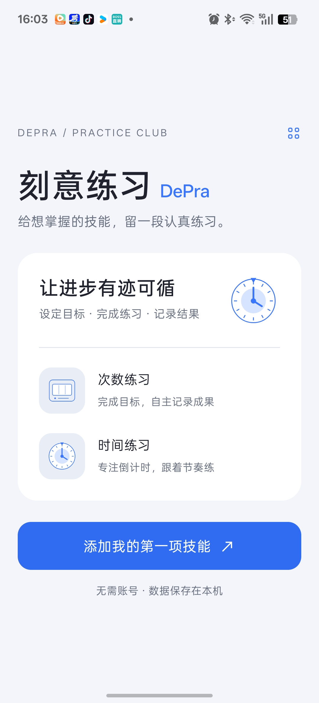
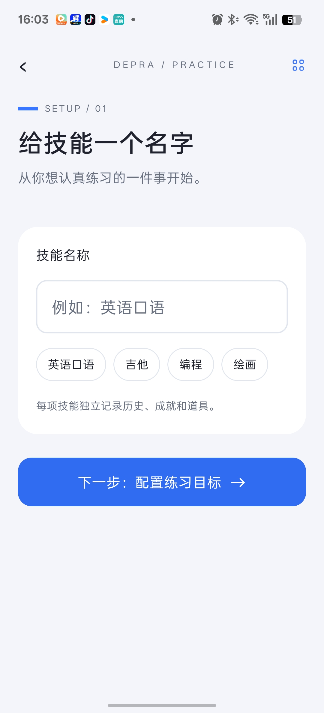
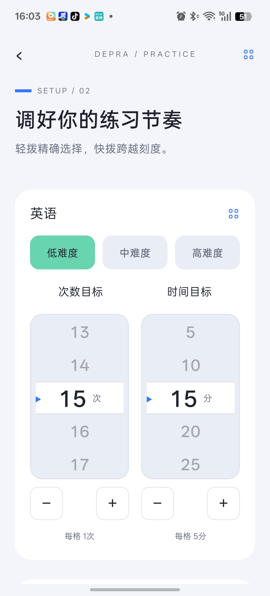
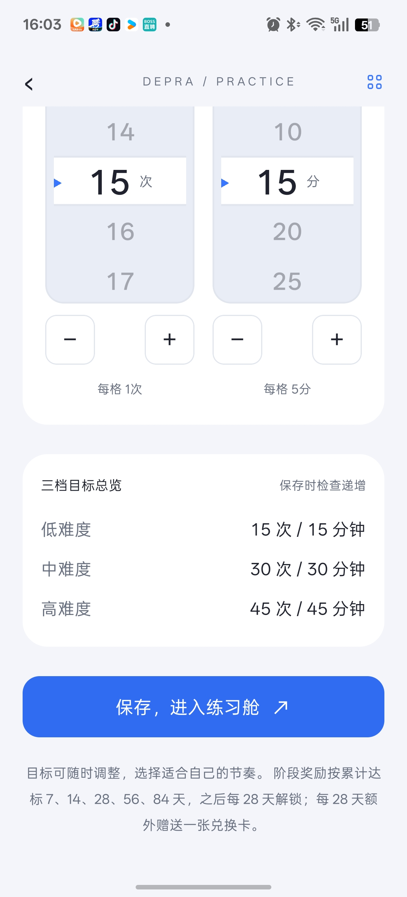
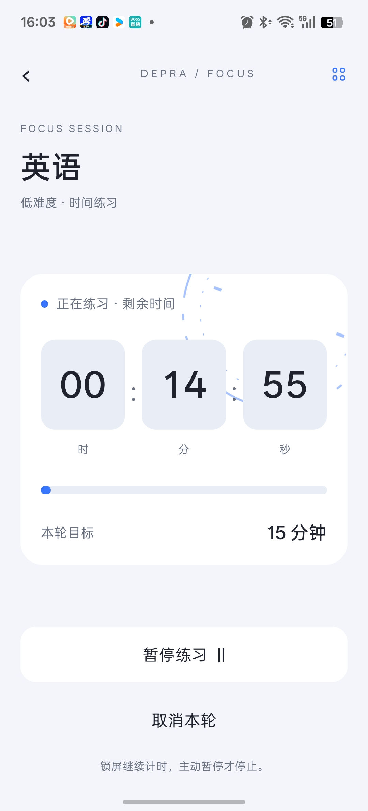
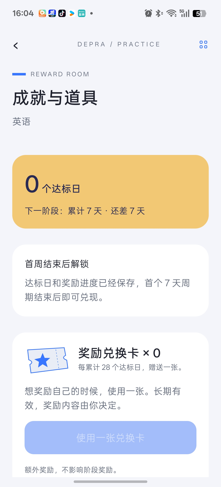
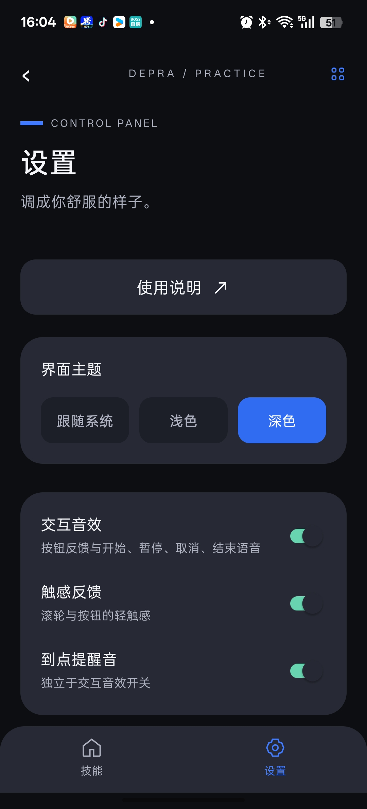

# 刻意练习 · DePra

设定技能目标，记录每一次认真练习。无需注册账号，练习数据保存在本机。

发布者：**Lxinz** · 联系：**2474069068@qq.com**

## 项目介绍

DePra 来自 Deliberate Practice（刻意练习）。它面向英语、乐器、编程、绘画等不同技能，帮助你把“想练习”变成一次有目标、可记录的练习。

使用流程：**创建技能 → 设置三档目标 → 选择次数或时间模式 → 专注练习 → 核对结果 → 查看历史与成就**。

每项技能独立保存目标、记录和奖励。次数模式不用逐次点击计数，完成后填写正确次数；时间模式使用倒计时，到点后确认完成。两种模式都支持暂停与继续，只有最终提交的有效结果计入达标和准确率。成就鼓励持续投入，不代表技能等级或掌握程度。

界面以 Studio Blue 为主题，使用蓝色强调、圆角卡片、薄荷色反馈和浅色/深色外观，配合离线中文语音、触感与倒计时动效。

## 技术栈

| 层面 | 技术 | 在项目中的用途 |
|---|---|---|
| 应用框架 | React Native 0.86.3 · Expo SDK 57 | Android 为主的移动端界面与原生能力集成 |
| UI 与语言 | React 19.2 · TypeScript 6 | 组件组织、类型约束与业务规则实现 |
| 本机数据 | expo-sqlite · AsyncStorage | 手机 SQLite 事务保存、旧数据迁移；Web 本地存储适配 |
| 视觉与动画 | react-native-svg · React Native Animated | 矢量图标、统一时分秒时钟与倒计时动效 |
| 声音与触感 | expo-audio · expo-haptics | 内置短音效、预生成中文语音与交互反馈 |
| 本地提醒 | expo-notifications | 可选每日提醒、练习到点通知及撤销 |
| Web 预览 | React Native Web · React DOM | 浏览器预览与页面交互验证 |
| 质量检查 | TypeScript · tsx / Node Test Runner | 类型检查、计时与业务规则、SQLite 事务测试 |
| 构建 | Node.js 22.23+ · npm · EAS Build | 锁定依赖、Android 云构建与签名 APK |

当前无需业务服务器或登录账号；中文语音为预生成资源，运行时不调用云 TTS。原生 SDK 的最终权限和联网行为仍需按发布包核验。

## 真机截图

以下 8 张图片由作者提供，来自 Android 真机使用。展示浅色主题下的引导、目标设置、首页、倒计时和成就，以及深色主题的设置页；界面内容以实际版本为准。

<table>
  <tr>
    <td align="center"><strong>首次引导</strong> </td>
    <td align="center"><strong>技能命名</strong> </td>
  </tr>
  <tr>
    <td align="center"><strong>目标滚轮</strong> </td>
    <td align="center"><strong>三档目标总览</strong> </td>
  </tr>
  <tr>
    <td align="center"><strong>技能首页</strong> </td>
    <td align="center"><strong>专注倒计时</strong> </td>
  </tr>
  <tr>
    <td align="center"><strong>成就与道具</strong> </td>
    <td align="center"><strong>深色设置</strong> </td>
  </tr>
</table>

## 下载与安装

当前版本：**0.3.3 测试版**，Android versionCode 6，最低 Android 7.0。

**[前往 GitHub Releases 下载 Android APK](https://github.com/1999-Lxinz/DePra/releases)**

1. 打开 Releases 页面，选择需要的版本。
2. 展开该版本的 **Assets（附件）**，下载以 `.apk` 结尾的安装包，例如 `DePra-0.3.3.apk`。
3. 在 Android 手机上打开 APK，按系统提示允许本次安装并完成安装。

`Source code (zip)` 和 `Source code (tar.gz)` 是仓库文件压缩包，不是手机安装包。若页面没有版本或 APK 附件，表示安装包尚未发布，请等待发布者上传。

更新请直接覆盖安装，勿先卸载。卸载或清除数据会丢失练习记录，目前不支持云同步或手动备份。

APK 应用签名证书 SHA-256：`dbfe3ab64ff5560a7ceeb9b04419408a0b59b51fb8b820a29ebbe8a8cb7a9da9`。它是公钥证书指纹，不是私钥。

## 功能

- 多技能独立目标，次数练习正计时和时间练习倒计时。
- 暂停、继续、结果核对、达标日历和准确率统计。
- 阶段成就、兑换卡、双主题、离线语音和可选本地提醒。

[使用说明](docs/usage.md) · [许可与版权](LICENSE)

## 项目与权利

本仓库仅用于官方说明和安装包分发，业务源码保存在私有仓库。原创内容保留版权和商业权利，用户可以按 LICENSE 安装使用官方 App；未经许可不得复制代码、改编发布、转售或以本品牌分发。第三方资源遵循各自许可。本项目不声称已取得专利。

隐私政策正在最终安装包核验与定稿阶段，本测试版介绍不代表已通过商店审核。正式发布前补齐定稿政策与第三方说明入口。
